# 👋 Hey, I'm Anay Biswas

### `Senior BI Developer` · `Data Engineer` · `AI Enthusiast`

**Turning Data into Intelligence. Building Technology that Matters.**

I build data-driven solutions, intelligent applications, and scalable systems that solve real-world business problems. Passionate about the intersection of **Business Intelligence, Data Engineering, and Generative AI.**

---

## 🌐 Connect With Me

  
  
  
  

---

## ⚡ Tech Arsenal

| Domain | Technologies |
|---|---|
| **Languages** | Python, JavaScript, TypeScript, SQL |
| **BI & Analytics** | Tableau, Power BI, Pandas, NumPy, Plotly |
| **AI & GenAI** | Gemini, Genkit, LangChain, RAG, NL2SQL |
| **Data Engineering** | ETL, Apache Airflow, PostgreSQL |
| **Databases** | PostgreSQL, MySQL, SQL Server, MongoDB, Redis, DynamoDB |
| **Backend & Frontend** | Node.js, React, Next.js, Supabase |
| **Cloud & Infrastructure** | AWS, Docker, Nginx, Cloudflare |
| **DevOps & Tools** | Git, GitHub Actions, CI/CD, Postman, Vercel |

---

## 🚀 What I'm Building

- **AI-powered Business Intelligence** – Making business analytics accessible through natural language.
- **DataSpeak AI** – Exploring Natural Language to SQL and intelligent data visualization.
- **Intelligent Automation** – Building AI-driven workflows and business automation tools.
- **Scalable Applications** – Developing production-oriented SaaS products and modern web applications.

## 📊 GitHub Analytics

  
  

  

---

## 🏆 GitHub Achievements

  

---

## 💡 Developer Mindset

> "Great technology isn't just about writing code. It's about solving problems that matter."

**Currently:** Learning · Building · Experimenting · Innovating

  

---

  

  <b>Data × AI × Engineering</b> 
  Building the future, one commit at a time.

